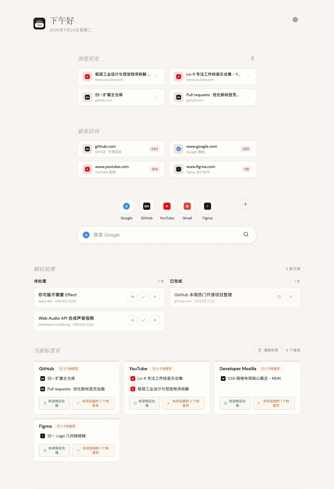
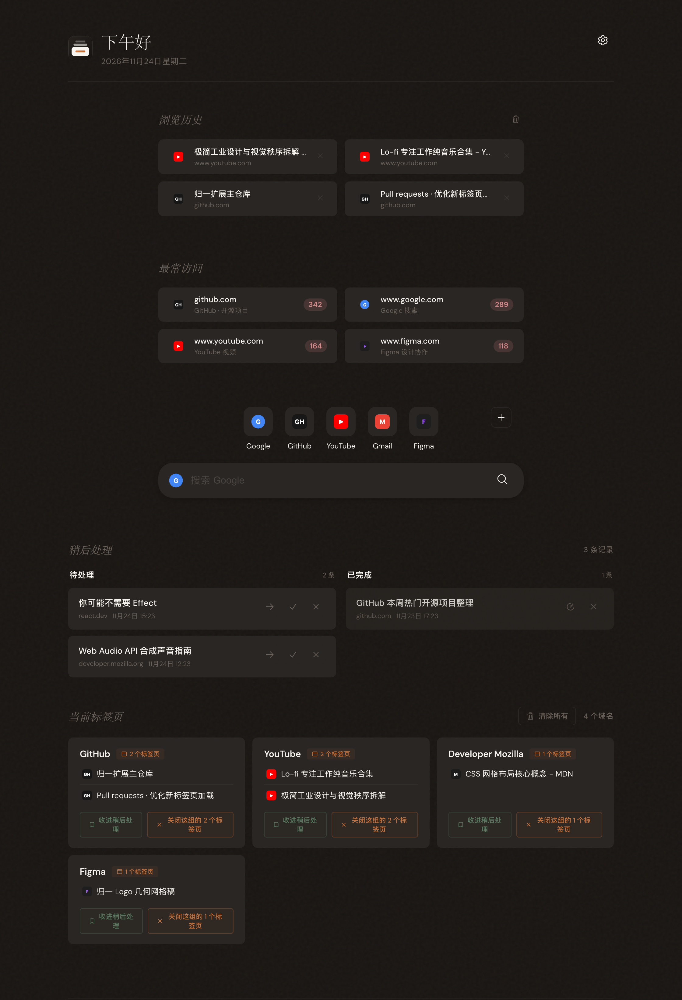

# 归一 (Guiyi)

**Manage your tabs, boost your browsing efficiency.**

归一 (Guiyi) is a Chrome extension that replaces your new tab page with a powerful dashboard to help you better manage all your open tabs.

## Language

- [中文](README.md) | [English](README.en.md)

---

## Preview





---

## Features

- **Tab grouping** - Automatically group tabs by domain for clear management
- **Theme switching** - Support for multiple themes (Light, Dark, Forest, Ocean) to adapt to different usage scenarios
- **Explosion effects** - Visual and auditory feedback (sound + confetti) when closing tabs
- **Browse history** - Automatically record and display recently visited websites
- **Favorite websites** - Customize and quickly access frequently used websites
- **Google search** - Integrated Google search box for quick searching
- **Local storage** - All data stored locally, protecting privacy
- **Responsive design** - Adapt to different screen sizes

---

## Installation

### Manual Installation

1. **Clone the repository**

```bash
git clone https://github.com/liangfeiiiii/tab-manager-pro.git
```

2. **Load the Chrome extension**

1. Open Chrome browser and go to `chrome://extensions`
2. Enable **Developer mode** (top-right toggle)
3. Click **Load unpacked**
4. Navigate to the `extension/` folder inside the cloned repo and select it

3. **Open a new tab**

You'll see the 归一 interface.

---

## Tech Stack

| Technology | Description |
|------------|-------------|
| Extension Type | Chrome Manifest V3 |
| Storage | chrome.storage.local |
| Sound | Web Audio API (synthesized, no files) |
| Animations | CSS transitions + JS confetti particles |
| Themes | CSS variables for multiple themes |

---

## License

Distributed under the [MIT License](LICENSE). See [LICENSE](LICENSE) for more information.

Copyright © 2026 FS Design

---

## Contributing

Welcome to submit Issues and Pull Requests!